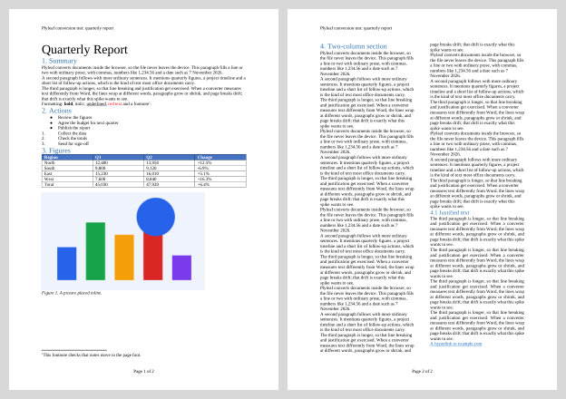
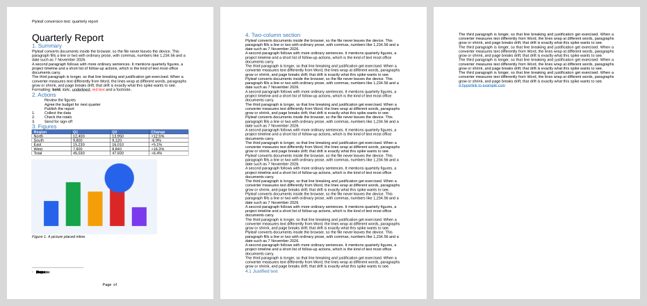
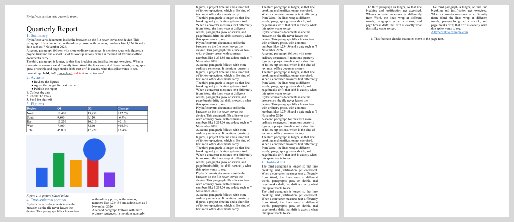
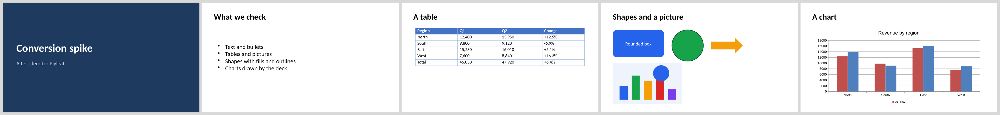
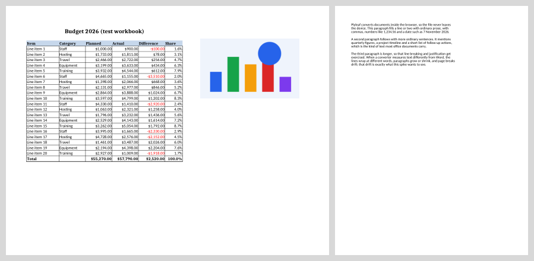
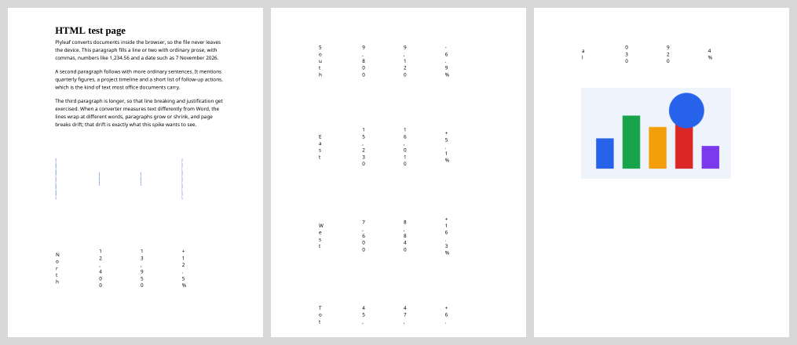

# Office conversion spike (D-007)

Date: 2026-11-07 · Milestone: M8 · Decision: [D-007](../DECISIONS.md), closed by **D-041: Office conversions dropped** (owner, 2026-11-07)

> **Outcome.** The owner chose not to ship any tool that needs a large WASM download, so none of the conversions below
> are built. The harness this report cites (`bench/office/`) was removed; it is in the git history at commit 5657f09.

**Question.** Can Plyleaf convert Word, Excel, PowerPoint, ODF and HTML to PDF (and PDF back to Office formats) in the
browser at a quality worth shipping? Or should the owner approve an opt-in conversion server (self-hosted Gotenberg),
which would be the only exception to "your file never leaves your device" (P3)?

**Answer.** Yes, it can be done client-side. **LibreOffice compiled to WebAssembly** converted every Office and ODF
test file correctly in Chromium, Firefox and WebKit, in under a second per file once loaded. A Gotenberg server would
not improve quality: **Gotenberg runs the same LibreOffice**, so the output would be the same. All a server buys is
avoiding a one-time **48 MB download**, and the price is a running server, monthly cost and an exception to P3. The
recommendation is **client-side only** (option A below), with the download disclosed up front.

Three things need care when building it (details under "Costs and risks"): the download size, hosting files larger
than Cloudflare's 25 MiB per-file limit, and Chromium sometimes hanging on a cold start (2 of 6 runs), which needs a
watchdog and retry.

## Candidates

| Candidate | Version | Licence | Covers | Measured |
|---|---|---|---|---|
| LibreOffice WASM (`@matbee/libreoffice-converter`) | 2.7.2 | MPL-2.0 | DOCX/DOC/XLSX/XLS/PPTX/PPT/ODT/ODS/ODP/RTF/HTML → PDF | yes |
| ZetaOffice (allotropia, LibreOffice WASM) | open beta | MPL-2.0 | same core as above | no (see below) |
| office2pdf (Rust + Typst) | 0.10.0 | Apache-2.0 | DOCX/XLSX/PPTX → PDF | no (see below) |
| docx-to-pdf-wasm (Rust) | 0.1.0 | MIT | DOCX → PDF | yes |
| docx-preview + browser print | 0.4.1 | Apache-2.0 | DOCX → HTML → print to PDF | yes |

- **ZetaOffice** loads its runtime from allotropia's CDN by default, and self-hosting means contacting the vendor.
  Loading it from their CDN would break the no-third-party-requests rule. It's the same LibreOffice core as the matbee
  build, which we can host ourselves, so it wasn't measured separately.
- **office2pdf** has native binaries but no prebuilt WASM, and building one needs a Rust toolchain, which this machine
  doesn't have. Its docs say the WASM build needs the fonts supplied by the caller and has no CJK font by default. It
  can be measured later if the owner wants a lighter, non-LibreOffice path compared (see "Open questions").

## Method

- **Test documents**: `bench/office/make-fixtures.ts` writes them with the `docx`, `exceljs` and `pptxgenjs` libraries.
  All text and the picture are generated, so the files are licence-clean.
  - `report.docx`: title, headings, body text, bold/italic/underline/colour, a footnote, bulleted and numbered lists, a
    shaded table, an inline picture, a header, a "Page X of Y" footer, a second section in two columns, justified text
    and a hyperlink.
  - `budget.xlsx`: a merged title, formulas (including ones with no cached value, so the converter has to recalculate),
    currency and percent formats with red negatives, borders, a picture, fit-to-one-page landscape, and a second sheet
    with wrapped text.
  - `deck.pptx`: 5 slides with a coloured background, bullets, a table, shapes (rounded rectangle, ellipse, arrow), a
    picture and a native bar chart.
  - `page.html`: headings, paragraphs, a table and an image.
  - ODF twins (`.odt/.ods/.odp`) are made by converting the OOXML files with LibreOffice.
- **Reference**: there is no Microsoft Office PDF to compare against. Automating Office on this machine stalled on a
  hidden prompt, so the fidelity judgement is visual: contact sheets of every output, below. The repeatable part is
  page count and whether each feature survives.
- **Speed**: `bench/office/convert.ts` (Node, the same WASM) and `bench/office/browser.ts` (Playwright: Chromium,
  Firefox, WebKit, a fresh context per run, files served from localhost with COOP/COEP headers). "Start" means loading
  and starting LibreOffice, with the download excluded because it's localhost.
- **Download size**: `bench/office/sizes.ts`, using the files each candidate fetches before its first conversion,
  compressed with gzip -9 and Brotli 11.
- **Machine**: Windows 11 desktop, headless Playwright browsers.

Re-run: `cd bench/office && pnpm install --ignore-workspace`, then from the repo root run
`node bench/office/make-fixtures.ts`, `node bench/office/convert.ts`, `node bench/office/browser.ts [runs] [browsers]`,
`node bench/office/sizes.ts`, `node bench/office/pdf-to-docx.ts` and `node bench/office/sheets.ts`.
Raw results are in [bench/office/results/](../../bench/office/results/).

## Results

### Download (one-time per device; cached after that, and kept offline once M9's PWA lands)

| Candidate | Raw | gzip | Brotli | At 10 Mbit/s | Largest file (raw) |
|---|---|---|---|---|---|
| LibreOffice WASM | 236 MB | 75 MB | **48 MB** | ~40 s | 141 MB (`soffice.wasm`; 47.5 MB gzipped) |
| docx-to-pdf-wasm | 2.3 MB | 1.1 MB | 0.8 MB | ~1 s | 2.3 MB |
| docx-preview + JSZip | 0.27 MB | 0.08 MB | 0.05 MB | instant | 0.2 MB |

For comparison, MuPDF (every PDF tool today) is 3.5 MB Brotli and the OCR engine plus English is about 5 MB.

### Speed (LibreOffice WASM, milliseconds)

| | Start | report.docx | budget.xlsx | deck.pptx |
|---|---|---|---|---|
| Chromium (median of 4 completed runs) | 1,190 | 1,140 | 390 | 620 |
| Firefox (2 runs) | 2,190 | 670 | 395 | 906 |
| WebKit (2 runs) | 2,340 | 395 | 275 | 442 |
| Node (warm, 2nd conversion) | n/a | 115 | 221 | 251 |

**Chromium hung on 2 of its 6 cold starts** (no result after 240 s). Firefox and WebKit finished all 4 of theirs. A
request for `soffice.data` was seen failing in one Chromium run, so a stalled fetch is the likely cause, but this isn't
confirmed. Either way, the product needs a timeout that restarts the worker and retries.

docx-to-pdf-wasm converted `report.docx` in 85 ms (39 ms warm). docx-preview rendered it in 94 ms before printing.

Memory wasn't measured: `measureUserAgentSpecificMemory` returned nothing in all three browsers. LibreOffice's own
guidance for its server image is at least 1 GiB. Memory on phones (especially iOS Safari's WASM limits) is the main
thing still to check, on a real device, in the build's first PR.

### Fidelity

| Feature (report.docx) | LibreOffice WASM | docx-to-pdf-wasm | docx-preview + print |
|---|---|---|---|
| Pages | 2 | 3 | 3 |
| Headings, body text, bold/italic/underline/colour | ✓ | ✓ | ✓ |
| Bulleted list | ✓ | ✗ (bullets dropped) | ✓ |
| Numbered list | ✓ | ✓ | ✓ |
| Shaded table | ✓ | ✓ (lighter borders) | ✓ |
| Inline picture | ✓ | ✓ | ✓ |
| Footnote at page foot | ✓ | ✗ (garbled glyphs) | ~ (moved to the end) |
| Header / "Page X of Y" footer | ✓ | ✗ ("Page  of", numbers missing) | ~ (header on page 1 only, no page numbers) |
| Section break to a new page | ✓ | ✓ | ✗ (flows on) |
| Two columns | ✓ | ✗ (one column) | ✓ |
| Hyperlink | ✓ | ✓ | ✓ |

- **Excel (LibreOffice)**: correct. It recalculated the formulas that had no cached value (Share column, 100.0% total),
  kept currency and percent formats with red negatives, the merged title, borders and the picture, fitted the sheet to
  one landscape page and printed the second sheet with wrapped text.
- **PowerPoint (LibreOffice)**: all 5 slides correct, including the background, bullets, table, shapes, picture and a
  native chart redrawn from its data.
- **ODF**: ODT, ODS and ODP gave the same pages as their OOXML twins.
- **HTML (LibreOffice)**: **not acceptable**. LibreOffice's HTML import squeezed the table into columns one character
  wide, across three pages. HTML → PDF should use the browser's own print engine instead (render the file in a
  sandboxed iframe and print it), which is what the browser does best and adds nothing to download.
- **Fonts**: the LibreOffice build includes Latin, Greek, Cyrillic, Arabic and Hebrew fonts, with metric-compatible
  stand-ins for Calibri, Arial and Times, so line breaks match Office closely. CJK and Indic need extra font packs
  (CJK is about 250 MB raw), loaded only when a document needs them.

Contact sheets (each converted PDF's pages side by side):

- LibreOffice, Word: 
- docx-to-pdf-wasm, Word: 
- docx-preview + print, Word: 
- LibreOffice, PowerPoint: 
- LibreOffice, Excel: 
- LibreOffice, HTML (the broken table): 

### PDF → Word / Excel / PowerPoint / text

This direction doesn't need the gate: LibreOffice can't write Office files from a PDF (it opens PDFs as drawings),
and a server wouldn't do it better. The client-side route is MuPDF's structured text, which gives the text with fonts,
sizes and positions, plus the images, written out by `docx` (0.17 MB Brotli), `exceljs` (0.19 MB) and `pptxgenjs`
(0.08 MB). This build of MuPDF.js doesn't include MuPDF's own DOCX writer ("DOCX/ODT writer not enabled"). PDF → text
already works with MuPDF.

A 60-line prototype (`bench/office/pdf-to-docx.ts`) turned each MuPDF text block into one Word paragraph. It ran in
51 ms but merged whole columns into one paragraph and dropped the table's structure and the picture
([round trip](office-spike/report.roundtrip.pdf-to-docx.png)). That's expected of a naive mapping. The real tool needs
paragraph splitting from line gaps, heading detection from font size, list detection, table detection from aligned
text and ruling lines (which Excel also needs), images placed inline, and columns. This is ordinary engineering on
data MuPDF already gives us, with no new heavy dependency.

## Costs and risks of LibreOffice WASM

1. **Download**: 48 MB Brotli, once per device. On a slow phone connection that's minutes. Mitigations: download only
   when an Office tool is used, never on landing pages (the rule for large WASM already); say the size before
   starting ("One-time 48 MB download; after that it works offline"); show real progress, which is honest (P5) rather
   than a fake wait; keep it cached and offline from M9.
2. **Hosting**: `soffice.wasm` is 141 MB raw and 47.5 MB gzipped, which is over the 25 MiB per-file limit of
   Cloudflare Workers static assets (both plans). Options: split it into chunks of 25 MiB or less and reassemble them
   in the worker (no WebAssembly streaming compile, so the start gets slightly slower), or serve it from Cloudflare R2
   on our own domain (free egress, 10 GB free storage; needs `plyleaf.com`, which is already on the owner's list).
   Either way it stays first-party.
3. **Cross-origin isolation**: LibreOffice's threads need `SharedArrayBuffer`, so the Office tool pages must send
   `Cross-Origin-Opener-Policy: same-origin` and `Cross-Origin-Embedder-Policy: require-corp`. We load nothing
   third-party, so this is cheap, but it's a new header set in `public/_headers` for those pages only.
4. **Chromium cold-start hang**: 2 of 6 runs. It needs a watchdog (no progress for N seconds → terminate the worker and
   retry once → clear error). Find the cause during the build.
5. **Licence**: MPL-2.0 (LibreOffice and the wrapper) is compatible with AGPL-3.0. It ships as separate files and its
   source is public.
6. **Maintenance**: the wrapper has one maintainer (matbee; 2.7.2, July 2026). We'd pin a version and keep a
   reproducible copy of the WASM files, since the fallback is building LibreOffice WASM ourselves, which is a large job.

## Options for D-007

| | A. Client-side only (recommended) | B. Client-side plus opt-in server fallback | C. Server only for Office |
|---|---|---|---|
| Files leave the device | Never | Only when the user picks "convert on our server" for that file | Always, for Office → PDF |
| Quality | LibreOffice | LibreOffice (Gotenberg uses it too) | LibreOffice |
| First use | 48 MB one-time download | Choose: 48 MB download or upload the file | Upload |
| Cost | None (static hosting; R2 free tier) | Server: about $5/month Workers Paid plus Containers usage, or a VPS; needs at least 1 GiB RAM | Same as B |
| Work | Build plus hosting tricks above | A plus a server, abuse limits, deletion, disclosure, privacy page | Server plus disclosure |
| Principles | Fully within P3 | P3 exception, opt-in and disclosed | Conflicts with P3 |

A server fallback mainly helps users on a slow connection or a low-memory phone. If phone memory turns out to be a real
blocker during the build, B can be revisited then, with data from real devices. Nothing in A prevents adding B later.

**Proposed quality bar for M8's "done when"** (the owner sets this):
- Word, Excel, PowerPoint and ODF → PDF: output matches LibreOffice desktop (the same engine), checked on the spike's
  fixtures plus a set of real-world-style files per format in E2E.
- HTML → PDF: the browser's print output.
- PDF → Word: editable text with paragraphs, headings, lists, tables and images in reading order; the layout is
  approximate, not pixel-exact. PDF → Excel: one sheet per detected table, with numbers as numbers. PDF → PowerPoint: one
  slide per page, with the page as a background image and the text as editable boxes over it. PDF → text: MuPDF text.

## Open questions for the owner

1. **D-007**: approve option A (client-side only)? Or B or C?
2. Is the proposed quality bar right?
3. Hosting the 141 MB WASM: chunk it on the current Workers host, or wait for `plyleaf.com` plus R2? (Chunking
   unblocks the build now.)
4. Optional: measure office2pdf too, by installing a Rust toolchain on this machine to build its WASM. It could be a
   lighter fast path for simple DOCX files, but at best it would sit alongside LibreOffice and wouldn't replace it.

## Sources

- LibreOffice WASM: [@matbee/libreoffice-converter](https://www.npmjs.com/package/@matbee/libreoffice-converter),
  [repo](https://github.com/matbeedotcom/libreoffice-document-converter); [ZetaOffice / zetajs](https://github.com/allotropia/zetajs),
  [ZetaOffice on Hacker News](https://news.ycombinator.com/item?id=42249746)
- [office2pdf crate](https://docs.rs/crate/office2pdf/latest), [releases](https://github.com/developer0hye/office2pdf/releases)
- [docx-to-pdf-wasm](https://www.npmjs.com/package/docx-to-pdf-wasm), [docx-preview](https://github.com/VolodymyrBaydalka/docxjs)
- Cloudflare: [Workers limits (25 MiB per static asset)](https://developers.cloudflare.com/workers/platform/limits/),
  [static assets billing and limits](https://developers.cloudflare.com/workers/static-assets/billing-and-limitations),
  [Workers pricing](https://developers.cloudflare.com/workers/platform/pricing/)
- Gotenberg: [installation and image variants](https://gotenberg.dev/docs/8.x/getting-started/installation)
